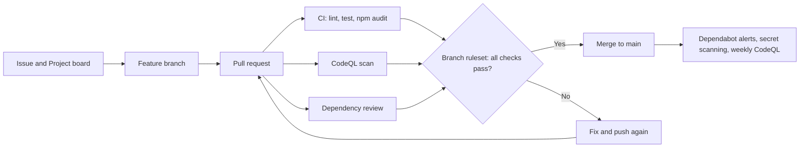

# Secure Node Notes API

A secure development workflow on GitHub (code scanning, dependency and secret protection, and protected pull requests) demonstrated on a small Node.js web app.

[](https://github.com/venkatapraneel-sketch/secure-node-devsecops/actions/workflows/ci.yml)
[](https://github.com/venkatapraneel-sketch/secure-node-devsecops/actions/workflows/codeql.yml)

## Overview

This project was built by Bysani Venkata Praneel as a university assignment grounded in the Microsoft Learn certificates "GitHub Foundations Part 1 of 2" and "GitHub Foundations Part 2 of 2". It demonstrates the practices those certificates cover by applying them to a real, working codebase.

The notes API itself is deliberately small: four endpoints backed by an in-memory store. The real value is the workflow around it. Every change flows through an issue, a feature branch, a pull request, and a suite of automated checks before it reaches `main`.

Those checks include CodeQL code scanning, CI lint and test runs, `npm audit` for production dependencies, and the dependency review action, all enforced by a branch ruleset. Dependabot keeps npm packages and GitHub Actions up to date each week. Secret scanning with push protection and private vulnerability reporting complete the security picture.

## Workflow



## Security controls

| Control | Where it lives | What it does |
| ------- | -------------- | ------------ |
| CodeQL code scanning | `.github/workflows/codeql.yml` | Scans JavaScript on every pull request to main, every push to main, and weekly |
| CI checks | `.github/workflows/ci.yml` | Runs lint, tests and `npm audit` (fails on high severity in production dependencies) |
| Dependency review | `.github/workflows/ci.yml` (pull requests only) | Blocks pull requests that add dependencies with known high-severity vulnerabilities |
| Dependabot | `.github/dependabot.yml` | Weekly update pull requests for npm packages and GitHub Actions, plus security alerts |
| Secret scanning and push protection | Repository settings | Detects and blocks pushes that contain supported secret patterns |
| Branch ruleset on `main` | Repository settings | Requires pull requests, passing status checks and code scanning results |
| Code owners | `.github/CODEOWNERS` | Assigns the maintainer as owner of the code |
| Least-privilege workflow tokens | `permissions:` blocks in the workflows | Limits what the GitHub token can do |
| API hardening | `src/app.js`, `src/validate.js` | Helmet security headers, rate limiting, 10 KB body limit, strict input validation, generic error responses |

## Certificate mapping

| What the project does | Certificate module |
| --------------------- | ------------------ |
| CodeQL code scanning workflow | Part 1: Configure code scanning on GitHub |
| Issues, branches, commits and pull requests as the way every change is made | Part 1: Introduction to Git; Introduction to GitHub |
| Pull-request-only changes into `main`, with review and merge | Part 2: Manage repository changes by using pull requests on GitHub |
| GitHub Projects board used for planning | Part 1: Manage your work with GitHub Projects |
| README, SECURITY.md, CONTRIBUTING.md and templates written in Markdown | Part 1: Communicate effectively on GitHub using Markdown |
| Dependabot, secret scanning, push protection, private vulnerability reporting, security policy | Part 2: Maintain a secure repository by using GitHub best practices |
| Branch ruleset, CODEOWNERS, roles and permissions | Part 2: Introduction to GitHub administration; Authenticate and authorize user identities on GitHub |
| Tracing the insecure commit with blame and history search during the demo | Part 2: Search and organize repository history by using GitHub |
| CONTRIBUTING.md, issue templates and PR template | Part 2: Contribute to an open-source project on GitHub; Manage an InnerSource program by using GitHub |
| Dev container for Codespaces | Part 1: Code with GitHub Codespaces |
| Overview of the GitHub features used (Actions, security features, Projects) | Part 1: Introduction to GitHub's products |

### Beyond the certificates

The lint/test/audit CI workflow, the dependency review action, and the Express hardening (Helmet, rate limiting, body-size limit, strict input validation, and generic error responses) go beyond what the two certificates cover. They were added because they represent standard, achievable practice for any Node.js project and make the security story more complete and credible.

## Getting started

**Prerequisites:** Node.js 20.19 or newer, Git.

```bash
# Install dependencies from the lockfile (use this in CI and for reproducible installs)
npm ci

# Start the server (production mode)
npm start

# Start with file watching (development mode)
npm run dev

# Run the linter
npm run lint

# Run tests
npm test

# Run tests with coverage report
npm run test:coverage

# Audit production dependencies for high or critical vulnerabilities
npm run audit:high
```

The server listens on port `3000` by default. Set the `PORT` environment variable to override it.

## API reference

| Method | Path | Description | Status codes |
| ------ | ---- | ----------- | ------------ |
| GET | `/health` | Liveness check | 200 |
| GET | `/api/notes` | List all notes | 200 |
| GET | `/api/notes/:id` | Get a note by ID | 200, 404 |
| POST | `/api/notes` | Create a note (body: `{"title": "...", "content": "..."}`) | 201, 400, 413, 429 |
| DELETE | `/api/notes/:id` | Delete a note by ID | 204, 404 |

**Example: create a note**

```bash
curl -s -X POST http://localhost:3000/api/notes \
  -H "Content-Type: application/json" \
  -d '{"title": "Hello", "content": "World"}' | jq
```

## Project structure

```
secure-node-devsecops/
├── .devcontainer/
│   └── devcontainer.json
├── .github/
│   ├── ISSUE_TEMPLATE/
│   │   ├── bug_report.md
│   │   └── feature_request.md
│   ├── workflows/
│   │   ├── ci.yml
│   │   └── codeql.yml
│   ├── CODEOWNERS
│   ├── dependabot.yml
│   └── pull_request_template.md
├── docs/
│   ├── DEMO_GUIDE.md
│   └── GITHUB_SETUP.md
├── src/
│   ├── app.js
│   ├── notesStore.js
│   ├── server.js
│   └── validate.js
├── tests/
│   └── app.test.js
├── .env.example
├── .gitignore
├── CONTRIBUTING.md
├── eslint.config.js
├── LICENSE
├── package-lock.json
├── package.json
├── README.md
└── SECURITY.md
```

## GitHub setup and demo

- Follow [`docs/GITHUB_SETUP.md`](docs/GITHUB_SETUP.md) to push to GitHub and configure repository settings, branch rulesets, and security features.
- Follow [`docs/DEMO_GUIDE.md`](docs/DEMO_GUIDE.md) to run the five-to-seven-minute demonstration showing the pipeline catching insecure changes.

## License

MIT. See [LICENSE](LICENSE).
